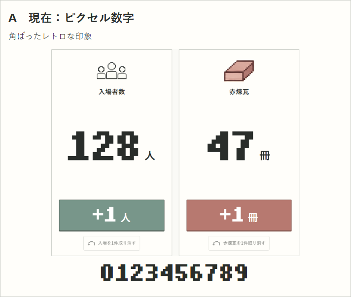
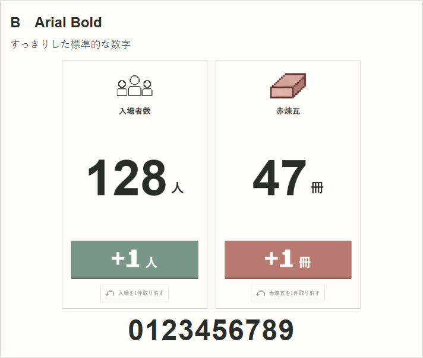
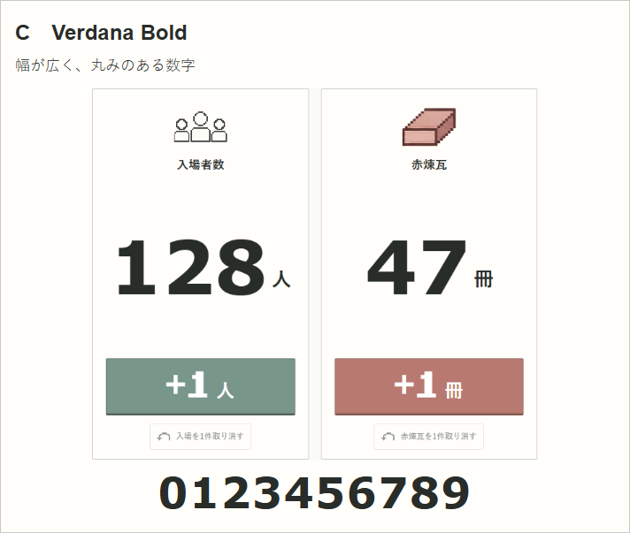
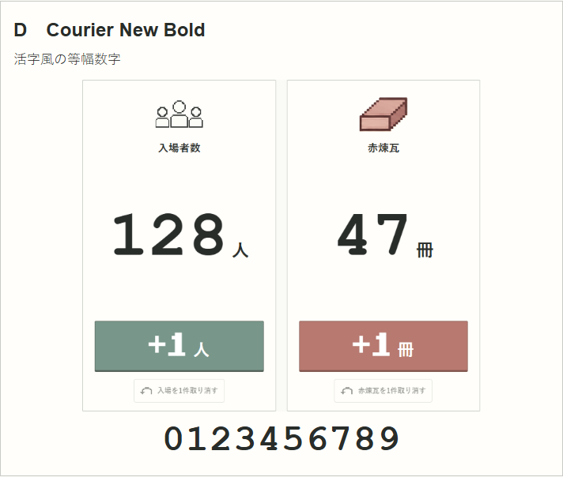

# 数字フォント比較

画像をタップすると拡大できます。架空の数字128／47を使用した比較資料です。アプリの公開フォントはまだ変更していません。

## A：現在のピクセル数字

## B：Arial Bold（すっきり）

## C：Verdana Bold（幅広）

## D：Courier New Bold（活字風）

2026-10-31。数字のみを同じ112px指定で比較した画面撮影。＋ボタンの寸法訂正済み。担当者名や実際の受付記録は含めていません。
